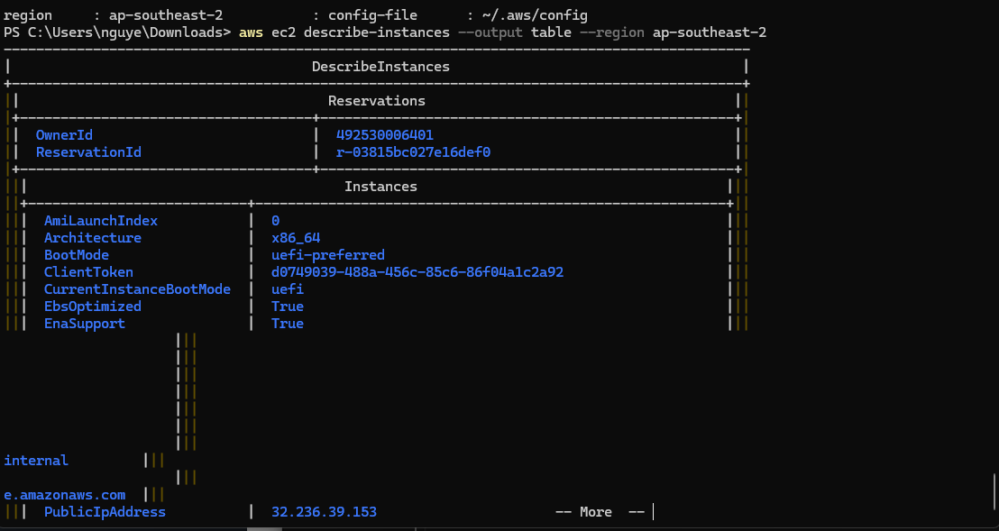

# Ghi chú học tập — 09/10/2026

- Tuần: 2 (05/10/2026–11/10/2026).
- Buổi theo lịch: Thứ Sáu — 09/10/2026; ngày phân bổ, không xác nhận ngày thực hiện.
- Ngày cập nhật: 11/10/2026.
- Vị trí FCJ: Mục 1 → `000011` → Kiểm tra tài nguyên, S3 và SNS; `000049` tạm bỏ qua vì lỗi CloudShell.
- Nguồn: xác nhận người học hoàn thành `000011` và ảnh thực hành đã kiểm tra.

## Nội dung học

- JSON thuận tiện đọc cấu trúc dữ liệu; table phục vụ quan sát; `--query` lọc kết quả hiển thị, không tự cấp thêm quyền.
- S3 bucket chứa objects; object key khác tên file local. Tên bucket phải đáp ứng tính duy nhất theo namespace sử dụng.
- SNS dùng luồng publisher → topic → subscription; email phải xác nhận đăng ký. Publish được chấp nhận và email được nhận là hai tiêu chí riêng.

## Thực hành và kết quả

### Đọc EC2

- Đã chạy `aws ec2 describe-instances`, nhận JSON trong account Happy Path.
- Đã chạy với `--output table --region ap-southeast-2`, nhận bảng instance.
- Output có tài nguyên; không ghi là danh sách rỗng. Ảnh JSON có thời điểm EBS AttachTime ngày 11/10/2026 UTC; đó là thời điểm gắn volume, không mặc định là thời điểm chụp ảnh.

### S3 — phần 5

Ảnh `aws_cli_s3.png` xác nhận:

1. Tạo tên bucket `aws-cli` bị BucketAlreadyExists; đã đổi tên riêng và tạo thành công.
2. Liệt kê bucket, upload một file dưới object key `hello.txt`, liệt kê object.
3. Xóa object, kiểm tra bucket rỗng, xóa bucket và chạy lại danh sách không hiển thị bucket lab.

**Trạng thái:** Hoàn thành thao tác S3 và cleanup bucket trong phạm vi ảnh.

**Điểm cần xử lý:** file nguồn upload là `aws-cli-keypair.pem`, không phải file văn bản mẫu. Nếu đây là private key SSH thật, cần xử lý như khóa đã được đưa ra ngoài máy: không tiếp tục dùng cho hệ thống cần bảo vệ, thay khóa phù hợp nếu còn máy sử dụng; không suy ra đã bị truy cập trái phép. Ảnh cho thấy object và bucket đã xóa, nhưng chưa có dữ liệu xác minh mọi bản sao hoặc việc sử dụng khóa còn lại. Các lần thử sau dùng file `.txt` không chứa thông tin xác thực.

Không chép nội dung file `.pem` hoặc khóa vào báo cáo. Ảnh S3 được giữ làm dữ liệu đối chiếu, chưa nhúng vào note này.

### SNS — phần 6

- Ảnh thư xác nhận thể hiện topic `aws-cli` ở `ap-southeast-2` và yêu cầu Confirm subscription.
- Ảnh `received_hello_from_pushlish.png` có email AWS Notification Message với nội dung `Hello`: đã kiểm chứng nhận thông báo, không chỉ tạo subscription.
- Hoàn thành thực hành SNS theo xác nhận người học. Chưa có ảnh publish/MessageId hoặc cleanup topic riêng.

Không nhúng ảnh email nhận tin nguyên bản vì có địa chỉ người nhận và URL hủy subscription; cần bản che dữ liệu đó trước khi dùng công khai.

### CloudShell — `000049`

Thông báo đã quan sát: không tạo được môi trường vì account verification đang diễn ra. Theo quyết định người học, **tạm bỏ qua, chưa tiếp tục thao tác CloudShell**; dùng CLI local cho `000011`. Không ghi hoàn thành `000049`, không tự xác định nguyên nhân sâu hơn hoặc đã hết lỗi.

## Kết quả đạt được

- Đọc tài nguyên thật bằng CLI và phân biệt output JSON/table.
- Thực hiện vòng đời bucket/object và kiểm tra cleanup S3.
- Kiểm chứng SNS gửi thông báo tới email.
- Xác định local CLI là môi trường tiếp tục học khi CloudShell bị chặn.

## Việc cần bổ sung

> **Cần bổ sung — Ngày/minh chứng:** Ngày thực hành EC2/S3/SNS thực tế; ảnh email đã che địa chỉ/URL subscription nếu dùng công khai; trạng thái cleanup SNS.

## Tài liệu

- [BTC — Kiểm tra tài nguyên](https://000011.awsstudygroup.com/vi/4-infras/).
- [BTC — S3](https://000011.awsstudygroup.com/vi/5-s3/).
- [BTC — SNS](https://000011.awsstudygroup.com/vi/6-sns/).
- [BTC — CloudShell](https://000049.awsstudygroup.com/vi/).
