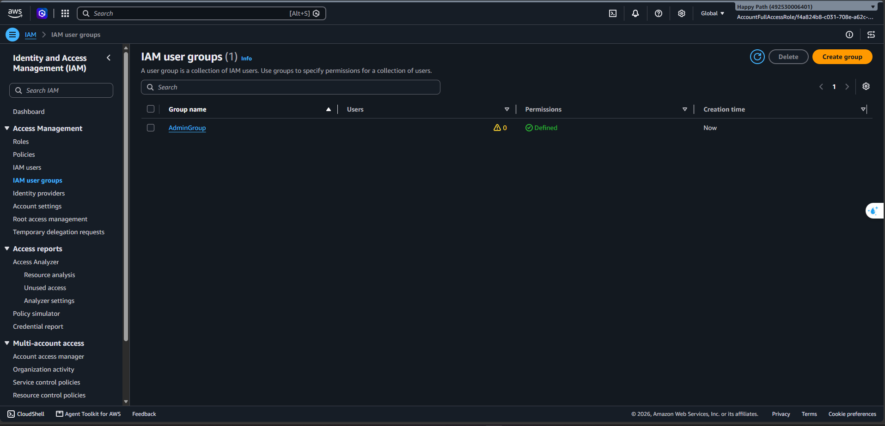
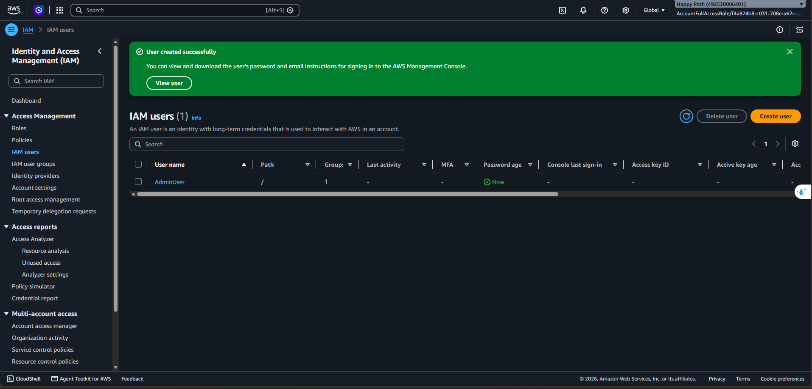
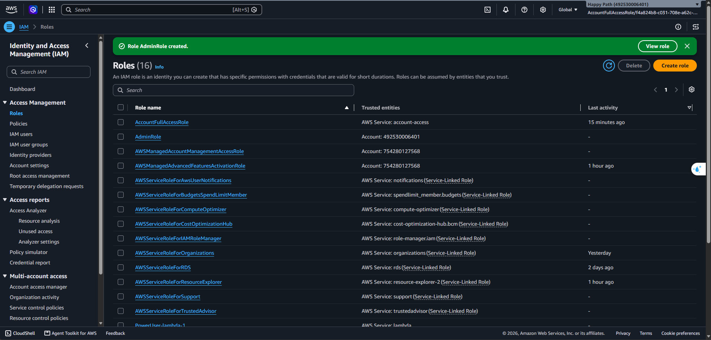
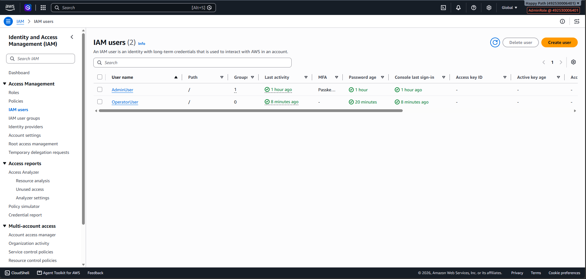

# Ghi chú học tập — 05/10/2026

- Tuần: 2 (05/10/2026–11/10/2026).
- Buổi theo lịch: Thứ Hai — 05/10/2026.
- Ngày cập nhật note: 11/10/2026.
- Phạm vi: Mục 1 — Explore AWS Services; kiến thức Region/AZ và bài `000002` — Quản trị quyền truy cập với AWS IAM.
- Nguồn kết quả: ghi nhận thực hành của người học và ảnh Console trong thư mục ảnh tuần 2. Ngày trong tên file là lịch phân bổ, chưa đủ để xác nhận ngày thực hiện mọi thao tác.

> **Cần bổ sung — Ngày thực hiện:** Ngày thực tế học lý thuyết, tạo user/group/role, kiểm tra Switch Role và dọn dẹp tài nguyên.

## Mục tiêu buổi học

- Phân biệt Region, Availability Zone (AZ), Data Center và Edge Location.
- Phân biệt xác thực với phân quyền; giải thích IAM user, group, policy và role.
- Thực hành tạo nhóm/user quản trị, tạo role, đăng nhập OperatorUser và Switch Role theo bài `000002`.
- Nhận diện danh tính đang dùng, áp dụng quyền phù hợp và dọn các đối tượng IAM của lab.

## Nội dung học

### 1. Region, AZ và Edge Location

| Khái niệm | Nội dung đã học |
| --- | --- |
| Region | Khu vực địa lý nơi AWS triển khai hạ tầng; ví dụ Singapore (`ap-southeast-1`), Tokyo (`ap-northeast-1`) và N. Virginia (`us-east-1`). |
| Availability Zone | Vị trí hạ tầng tách biệt trong một Region, gồm một hoặc nhiều Data Center. Một Region có nhiều AZ. |
| Data Center | Trung tâm dữ liệu vật lý chứa máy chủ, thiết bị mạng và hệ thống lưu trữ. |
| Edge Location | Điểm hiện diện gần người dùng, phục vụ các dịch vụ như CloudFront để phân phối/cache nội dung và Route 53 để trả lời DNS. Không phải mọi dịch vụ hoặc dữ liệu đều được đưa ra edge. |

**Vì sao phân bố hạ tầng ở nhiều nơi?**

- **Độ trễ:** chọn Region gần người dùng có thể giảm độ trễ; kết quả còn phụ thuộc mạng và dịch vụ.
- **Vị trí dữ liệu:** lựa chọn Region cần phù hợp yêu cầu lưu trữ/xử lý dữ liệu của hệ thống.
- **Cô lập sự cố:** các AZ có hạ tầng điện, làm mát và mạng tách biệt, kết nối với nhau bằng mạng độ trễ thấp. Triển khai phù hợp trên nhiều AZ giúp tăng tính sẵn sàng khi một AZ gặp sự cố.
- **Khôi phục thảm họa:** dùng Region khác có thể hỗ trợ dự phòng nếu đã thiết kế sao lưu, đồng bộ và khôi phục; không tự có chỉ vì AWS cung cấp nhiều Region.

**Điểm cần nhớ:** chọn Region không tự triển khai ứng dụng trên mọi AZ. Region được bật cũng không chứng minh đã có tài nguyên ở đó.

**Quan sát tài khoản:** sau khi bật Advanced features, Console hiển thị nhiều Region, với trạng thái `Enabled by default` hoặc `Disabled`. IAM hiển thị `Global`, nên cần mở dịch vụ theo Region như EC2 để xác định Region đang chọn.

> **Cần bổ sung — Region/AZ thực tế:** Region đang chọn trong dịch vụ theo Region; dịch vụ/tài nguyên đã kiểm tra và Region tương ứng; tên AZ đã quan sát nếu có. Chưa có dữ liệu để kết luận đã triển khai nhiều AZ.

Tài liệu học: [Video nhập môn AWS](https://youtu.be/qVCF7UjYC5s?si=7lYUyc8oN5SsEPRu).

### 2. IAM và cơ chế cấp quyền

**AWS Identity and Access Management (IAM)** quản lý danh tính và quyền truy cập tài nguyên AWS.

- **Authentication — xác thực:** xác minh danh tính đăng nhập/gửi yêu cầu.
- **Authorization — phân quyền:** đánh giá danh tính đó có được thực hiện hành động trên tài nguyên hay không. Đăng nhập thành công không đồng nghĩa có quyền quản trị.

| Thành phần | Vai trò | Liên hệ với lab |
| --- | --- | --- |
| IAM user | Danh tính bên trong một AWS account; có thể được cấp mật khẩu Console hoặc thông tin xác thực phù hợp. | `AdminUser`, `OperatorUser`. |
| IAM group | Tập hợp IAM users để quản lý quyền chung; không tự đăng nhập và không chứa role. | `AdminGroup`. |
| IAM policy | Quy tắc cho phép/từ chối hành động, tài nguyên và điều kiện áp dụng. | `AdministratorAccess` được ghi nhận dùng trong lab quản trị. |
| IAM role | Danh tính được sử dụng thông qua AssumeRole, với credentials tạm thời. | `AdminRole`. |

Hai luồng cần phân biệt:

```text
AdminUser → AdminGroup → permissions policy → quyền thực hiện hành động
OperatorUser → AssumeRole/Switch Role → AdminRole → quyền trong phiên role
```

**Role không được gắn vào user/group như permissions policy.** Việc chuyển role cần cấu hình quyền nhận role và trust policy phù hợp. Trust policy xác định ai được nhận role; permissions policy xác định phiên role được làm gì.

**Switch Role / Switch back:** khi chuyển sang `AdminRole`, phiên sử dụng quyền của role thay cho quyền user ban đầu, không cộng hai bộ quyền. Switch back quay về danh tính ban đầu; không hoàn tác tài nguyên hoặc cấu hình đã thay đổi. Role có thể có quyền cao hơn, thấp hơn hoặc khác user.

Tài liệu: [FCJ — IAM `000002`](https://000002.awsstudygroup.com/vi/), [AWS — Switch Role](https://docs.aws.amazon.com/IAM/latest/UserGuide/id_roles_use_permissions-to-switch.html).

### 3. Phân biệt account và danh tính đăng nhập

- **Happy Path:** project ban đầu có AWS account tương ứng; tài nguyên và các user/role của lab nằm trong account này.
- **Builder ID:** hồ sơ đăng nhập cá nhân dùng để truy cập AWS Settings và các account được cấp quyền. Trong ảnh cấu hình lab, phiên đang dùng `AccountFullAccessRole`, không phải root.
- **AdminUser / OperatorUser:** IAM users được tạo bên trong account, không phải AWS accounts mới.
- **Root user:** danh tính gốc của từng AWS account, tách biệt với Builder ID và IAM users. Cùng email không có nghĩa mật khẩu/MFA được đồng bộ.
- **Management Account:** quản lý tổ chức và thanh toán chung.
- **Identity Delegated Admin:** account quản trị danh tính thành viên qua IAM Identity Center; không phải `AdminUser` của lab.

Sau khi bật Advanced features, AWS cho phép tự quản lý tổ chức và dùng nhiều Region. Team name là tên hiển thị của IAM Identity Center, không phải IAM group của lab. Việc kích hoạt không thể hoàn tác và xóa spend limit hiện có; cảnh báo AWS Budgets không tương đương giới hạn chi tiêu tự động.

Tài liệu: [AWS — Advanced features](https://docs.aws.amazon.com/accounts/latest/reference/activate-advanced-features.html), [Builder ID và các danh tính AWS khác](https://docs.aws.amazon.com/signin/latest/userguide/differences-builder-id.html).

## Thực hành và kết quả

### 1. Tạo IAM Group và IAM User

Tài liệu: [`000002` — Tạo IAM Group và IAM User](https://000002.awsstudygroup.com/vi/2-create-admin-user-and-group/).

- Đã bật Advanced features để tiếp tục thao tác IAM group trên môi trường đang dùng, theo ghi nhận của người học.
- Đã tạo `AdminGroup` và `AdminUser`; ghi nhận cấu hình quyền quản trị bằng `AdministratorAccess` và thêm user vào nhóm.
- MC-01 xác nhận group tồn tại, nhưng lúc chụp chưa có user trong group. MC-02 xác nhận tạo user thành công và user thuộc một group; ảnh chưa hiển thị tên group hoặc policy chi tiết.
- MC-04 cho thấy `AdminUser` đã có hoạt động đăng nhập Console. Đây là kết quả sau bước tạo, không phải trạng thái tại MC-02.

**Trạng thái:** Hoàn thành phạm vi tạo group/user và đăng nhập theo ghi nhận thực hành; chưa có ảnh chi tiết để đối chiếu policy và tên group của user.

### 2. Tạo role và chuyển quyền tạm thời

Tài liệu: [Tạo IAM Role và IAM User](https://000002.awsstudygroup.com/vi/3-aws-role/), [Chuyển đổi IAM Role](https://000002.awsstudygroup.com/vi/4-switch-roles/).

- Đã tạo `AdminRole` và `OperatorUser`, đăng nhập bằng OperatorUser rồi thực hiện Switch Role theo ghi nhận của người học.
- MC-03 xác nhận `AdminRole` được tạo thành công.
- MC-04 hiển thị danh tính phiên là `AdminRole` và đọc được danh sách có `AdminUser`, `OperatorUser`. Ảnh xác nhận phiên role hoạt động; không tự chứng minh mọi quyền quản trị hoặc toàn bộ trust/permissions policy.
- Đã phân biệt Switch back với việc xóa role: Switch back chỉ quay về phiên ban đầu, role vẫn tồn tại cho đến khi được xóa.

**Trạng thái:** Hoàn thành phạm vi tạo role/user và Switch Role, dựa trên ghi nhận thực hành và MC-03–MC-04. Chưa có minh chứng riêng về phép kiểm tra quyền sau Switch back.

### 3. Dọn dẹp tài nguyên IAM

Tài liệu: [`000002` — Dọn dẹp tài nguyên](https://000002.awsstudygroup.com/vi/5-cleanup/).

Người học ghi nhận đã xóa `AdminUser`, `OperatorUser`, `AdminGroup` và `AdminRole` trong account làm lab. Đây là cleanup các đối tượng IAM của bài; không có nghĩa đã xóa các account quản trị, mọi role hệ thống hoặc mọi tài nguyên ở các Region.

**Trạng thái:** Đã thực hiện theo ghi nhận thực hành; chưa có ảnh/log kiểm tra danh sách sau cleanup.

> **Cần bổ sung — Minh chứng cleanup:** Ảnh hoặc log danh sách Users, User groups và Roles sau khi dọn, xác nhận bốn đối tượng lab không còn tồn tại; kèm ngày kiểm tra thực tế.

## Minh chứng hiện có

Các ảnh ghi nhận trạng thái tại thời điểm thực hành, không phản ánh trạng thái hiện tại sau cleanup.

**MC-01 — AdminGroup đã tồn tại, chưa có thành viên tại thời điểm chụp.**



**MC-02 — AdminUser được tạo thành công và thuộc một group.**



**MC-03 — Console xác nhận tạo AdminRole thành công.**



**MC-04 — Phiên AdminRole đọc được danh sách hai IAM users.**



Ảnh MC-04 cũng cho thấy cột MFA của AdminUser có nội dung bắt đầu bằng `Passke…`, còn OperatorUser là `—`. Chưa có ảnh chi tiết thiết bị MFA để xác nhận đầy đủ cấu hình.

## Vấn đề gặp phải và bài học

| Hiện tượng | Kết luận có căn cứ | Cách xử lý / điều học được |
| --- | --- | --- |
| IAM user groups báo Feature unavailable. | Giao diện yêu cầu bật Advanced features. | Đã kích hoạt theo ghi nhận thực hành và sau đó tạo được group. Hiểu thay đổi về quản trị, Region và spend limit. |
| Đăng nhập được bằng Builder ID nhưng root báo Authentication failed. | Chưa xác định mật khẩu root không hợp lệ hay root sign-in bị vô hiệu hóa. | Không coi mật khẩu Builder ID là mật khẩu root; tiếp tục truy cập bằng danh tính được phép. Chưa ghi nhận đã khôi phục root. |
| OperatorUser gặp Access denied với `iam:GetUser` và `iam:GetLoginProfile`. | Lỗi nêu không có identity-based policy cho phép các action này tại phiên user. | Đăng nhập thành công không đồng nghĩa có quyền IAM. Thực hiện Switch Role để dùng quyền role; MC-04 xác nhận đọc được danh sách users trong phiên role. |
| Sau kích hoạt xuất hiện nhiều account và Region. | Account quản trị và danh sách Region không phải các tài nguyên lab vừa tạo. | Tiếp tục làm lab trong Happy Path; chỉ ghi tài nguyên/Region thực tế đã kiểm tra. |

## Bảo vệ tài khoản — phạm vi đã kiểm tra

| Hạng mục | Ghi nhận |
| --- | --- |
| Account làm lab | Happy Path. |
| Danh tính dùng | Phiên Builder ID qua `AccountFullAccessRole` để cấu hình; `AdminUser`, `OperatorUser` và phiên `AdminRole` trong lab. |
| MFA của IAM users | MC-04 có dấu hiệu MFA/passkey của AdminUser; OperatorUser chưa hiển thị thiết bị MFA tại thời điểm chụp. Các user được ghi nhận đã xóa sau lab. |
| MFA của Builder ID và root | Chưa xác minh. MFA của AdminUser không chứng minh MFA của root. |
| Mật khẩu root mạnh và riêng biệt | Chưa xác minh. |
| Root access key | Chưa xác minh; không suy từ cột access key của IAM users. |
| Biện pháp đã áp dụng | Thực hành quyền tạm thời qua Switch Role; ghi nhận đã dọn user/group/role của lab. |

> **Cần bổ sung — Bảo vệ account:** Trạng thái MFA của Builder ID và root Happy Path; trạng thái thông tin xác thực root (có mật khẩu/đã loại bỏ/chưa xác minh), root access key và ngày kiểm tra. Không ghi mật khẩu, secret key, token hoặc mã QR MFA vào note.

## Kết quả đạt được

- Phân biệt được Region/AZ/Data Center và vai trò của Edge Location; hiểu nhiều AZ hỗ trợ tính sẵn sàng khi được triển khai phù hợp.
- Phân biệt được AWS account, Builder ID, root và IAM user; xác định phiên user khác phiên role.
- Đã thực hành các phần tạo group/user, tạo role/user và Switch Role của bài `000002`; có ảnh xác nhận tạo đối tượng và phiên AdminRole.
- Đã ghi nhận cleanup bốn đối tượng IAM của lab. Chưa xác minh lại bằng ảnh/log sau xóa.
- Chưa đủ dữ liệu để kết luận hoàn thành toàn bộ mục bảo vệ account, đã triển khai multi-AZ hoặc hoàn thành mọi nội dung nâng cao của bài IAM.

## Câu hỏi và việc cần làm tiếp

1. Bổ sung ngày thực hiện thực tế để phân biệt với ngày phân bổ trong tên note.
2. Ghi Region/tài nguyên/AZ đã kiểm tra và ngày quan sát; không lấy danh sách Region được bật làm danh sách Region có tài nguyên.
3. Bổ sung kết quả kiểm tra root/MFA và ảnh sau cleanup nếu đã lưu. Không cần tạo lại quyền quản trị chỉ để chụp ảnh.
4. Khi thực hành role lần tiếp theo, lưu trust policy, permissions policy và phép thử trước/sau Switch Role hoặc Switch back bằng cùng một action.
5. Tiếp tục học cách đọc `Effect`, `Action`, `Resource`, `Condition` và phân biệt implicit deny với explicit deny theo lịch tuần 2.
