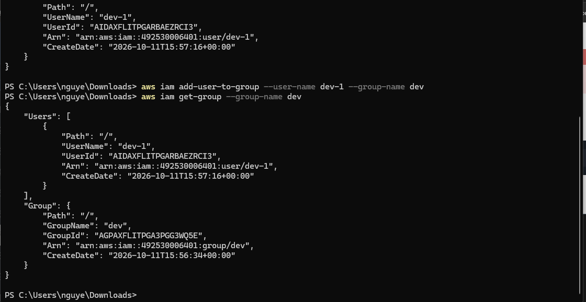
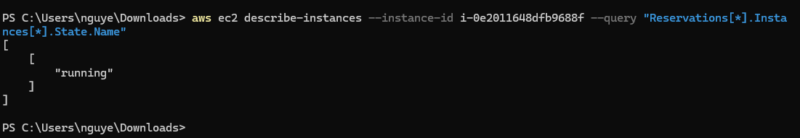
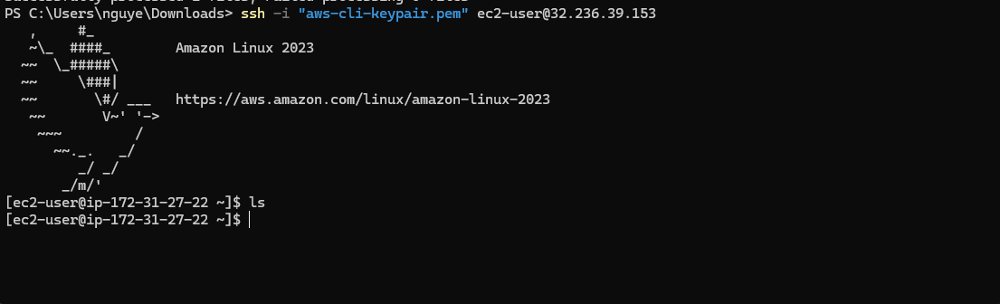

# Ghi chú học tập — 10/10/2026

- Tuần: 2 (05/10/2026–11/10/2026).
- Buổi theo lịch: Thứ Bảy — 10/10/2026; ngày phân bổ, không xác nhận ngày thực hiện.
- Ngày cập nhật: 11/10/2026.
- Vị trí FCJ: Mục 1 → `000011` → IAM, VPC/Internet Gateway, EC2 và cleanup; đối chiếu tiêu chí kiểm thử quyền của tuần 2.
- Nguồn: người học xác nhận hoàn thành toàn bộ `000011`; ảnh IAM/EC2 đã kiểm tra.

## Nội dung học

- CLI thực hiện được các thao tác IAM như Console; tạo user/group không tự cấp quyền nếu chưa có policy.
- Access key dùng xác thực request, khác mật khẩu Console; credentials không tự cấp quyền.
- VPC và Internet Gateway phục vụ mạng; quyền IAM cho API không thay thế điều kiện mạng, route hoặc security group.
- Đọc trạng thái instance qua CLI khác việc SSH vào hệ điều hành. SSH thành công không chứng minh ứng dụng đã đọc S3 bằng IAM role.

## Thực hành và kết quả

| Phần của `000011` | Kết quả | Cơ sở |
| --- | --- | --- |
| IAM | Tạo group `dev`, user `dev-1`; thêm user vào group và kiểm tra bằng get-group. | Hai ảnh IAM bên dưới. |
| Access key IAM | Tạo/xóa theo phạm vi lab được người học xác nhận hoàn thành; chưa có output riêng. | Xác nhận hoàn thành lab, không có key/secret trong note. |
| VPC/Internet Gateway | Đã thực hiện theo xác nhận hoàn thành toàn bộ lab. Chưa ghi nhận tên/ID, CIDR hoặc output các bước. | Ghi nhận thực hành; không tự điền cấu hình theo mẫu BTC. |
| EC2 | Đọc trạng thái instance trả về `running`; SSH thành công, hiện Amazon Linux 2023. | Ảnh trạng thái/SSH bên dưới. |
| Cleanup toàn bài | Ghi nhận đã hoàn thành lab, gồm phần cleanup; chưa có kiểm kê sau xóa cho IAM/network/EC2 phụ thuộc. | Xác nhận người học. S3 có minh chứng cleanup riêng ở note Thứ Sáu. |

Ảnh tạo group/user có CreateDate ngày **11/10/2026 UTC**, nên xác nhận đối tượng được tạo ngày 11/10/2026, không ghi thành 10/10 chỉ để khớp lịch. Chưa xác định ngày thực hiện toàn bộ các phần khác.

Lần chạy create-group thứ hai trả EntityAlreadyExists vì `dev` đã tồn tại sau lần tạo thành công; không phải bằng chứng lỗi quyền IAM.

## Minh chứng

## Đối chiếu phép thử quyền trước/sau

Đã có mô phỏng Allow/Deny trong note Thứ Ba và Switch Role trong note Thứ Hai. Hoàn thành `000011` chưa tự chứng minh đã làm phép thử bổ sung **cùng role, action, Region trước/sau thêm một quyền hẹp**. Hiện chưa có kết quả riêng để đánh dấu tiêu chí đó hoàn thành.

> **Cần bổ sung — Phép thử quyền:** Nếu đã làm, bổ sung action, role, Region, policy trước/sau và output AccessDenied → thành công. Nếu chưa làm, giữ trạng thái chưa kiểm chứng; không thay bằng lỗi tên group/bucket đã tồn tại.

## Kết quả đạt được

- Quản lý user/group qua CLI và kiểm tra quan hệ thành viên thực tế.
- Đã thực hành VPC/Internet Gateway và EC2 theo xác nhận hoàn thành lab; có ảnh đọc trạng thái và SSH.
- Phân biệt lỗi trùng tên với lỗi thiếu quyền, kiểm tra API với kiểm tra kết nối SSH.

## Việc cần bổ sung

> **Cần bổ sung — Phạm vi và cleanup:** Ngày thực hiện VPC/EC2, cấu hình chính đã dùng và trạng thái sau dọn của IAM user/group/access key, VPC/Internet Gateway, EC2/volumes/IP. Không tự coi instance đã terminate là mọi tài nguyên phụ thuộc đã xóa.

## Tài liệu

- [BTC — IAM qua CLI](https://000011.awsstudygroup.com/vi/7-iam/).
- [BTC — Toàn bộ lab CLI và menu VPC/EC2/cleanup](https://000011.awsstudygroup.com/vi/).
