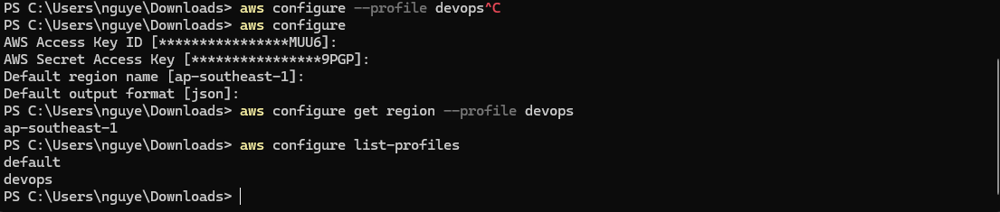
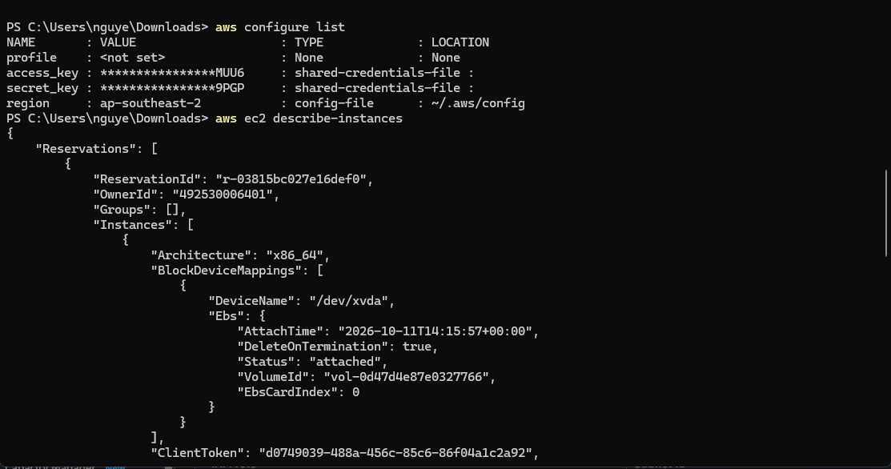

# Ghi chú học tập — 08/10/2026

- Tuần: 2 (05/10/2026–11/10/2026).
- Buổi theo lịch: Thứ Năm — 08/10/2026; ngày phân bổ, không xác nhận ngày thực hiện.
- Ngày cập nhật: 11/10/2026.
- Ngày thực hành thực tế: Chưa ghi nhận cho toàn bộ buổi.
- Vị trí FCJ: Mục 1 — Explore AWS Services → `000011` → Giới thiệu, Chuẩn bị, Cài đặt CLI và profile.
- Nguồn: xác nhận người học đã hoàn thành `000011` và ảnh CLI đã kiểm tra.

## Nội dung học

- AWS CLI gửi request tới AWS API; credentials xác thực danh tính, IAM policy quyết định quyền.
- PowerShell là môi trường chạy lệnh trên Windows, khác AWS CLI và CloudShell.
- Profile là bộ cấu hình đăng nhập, Region, output; profile không tự cấp quyền.
- `--profile` chọn cấu hình; `--region` chọn Region cho request và có thể ghi đè mặc định; `--output` đổi cách trình bày, không đổi quyền.
- Phân biệt lỗi cài đặt/PATH, thiếu hoặc hết hạn credentials, AccessDenied và danh sách rỗng do account/Region/phạm vi kiểm tra.

## Thực hành và kết quả

| Nội dung | Kết quả thực tế / nguồn |
| --- | --- |
| Cài đặt AWS CLI và cấu hình | Đã thực hiện theo xác nhận hoàn thành lab; ảnh các lệnh AWS chạy trong PowerShell. Chưa có output `aws --version` để ghi phiên bản cụ thể. |
| Phương thức xác thực | Ảnh `aws configure list` cho thấy access key từ shared credentials file; không ghi là đã dùng `aws login`. Giá trị khóa trong ảnh đã được CLI che phần lớn. |
| Profiles | `aws configure list-profiles` hiển thị `default` và `devops`. |
| Region của devops | `aws configure get region --profile devops` trả về `ap-southeast-1`. |
| Region mặc định tại ảnh đọc EC2 | `aws configure list` không chọn named profile, hiển thị Region `ap-southeast-2`. Hai profile/ảnh có Region khác nhau, không đồng nhất chúng. |
| Danh tính CLI | Output EC2 xác nhận OwnerId của Happy Path; chưa có output STS để xác định chính xác IAM user/role đang dùng credentials. |

**Trạng thái:** Hoàn thành phạm vi CLI/profile theo xác nhận người học; phiên bản và caller ARN chưa có minh chứng.

## Minh chứng

Ảnh xác nhận devops có Region `ap-southeast-1`; không xác nhận thao tác tạo profile ở dòng bị hủy bằng Ctrl+C đã hoàn tất.

## Kết quả đạt được

- Sử dụng CLI local trong PowerShell dù CloudShell chưa tạo môi trường được.
- Kiểm tra profile/Region và hiểu khác biệt cấu hình mặc định với named profile.
- Có lệnh CLI thực tế và output; không chỉ học mô phỏng policy.

## Việc cần bổ sung

> **Cần bổ sung — Ngày và môi trường:** Ngày thực hành thật, phiên bản CLI và output `get-caller-identity` đã che thông tin không cần thiết; không đưa secret key/token vào note.

## Tài liệu

- [BTC — Cài đặt CLI và profile](https://000011.awsstudygroup.com/vi/3-installcli/).
